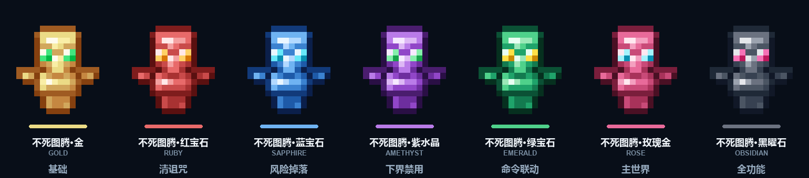

# NHTotem × CraftEngine 图腾教程包 v1.1

适用：**CraftEngine 26.9.2+**、**NHTotem 0.1.3+**  
内容：7 个 16×16 不死图腾材质 + 7 套功能预设 + `items.yml` + NHTotem 示例配置。

> NHTotem 0.1.3 起，图腾触发动画会自动使用对应颜色材质（临时切主手播放，结束立即还原）。



---

## 0. 先看懂：这 7 个图腾分别干什么

先说清楚：**颜色本身不决定功能。**  
7 个图腾用的是同一套 NHTotem 核心逻辑，下面这些“功能”是每个图腾在 `NHTotem/config.yml` 里的**配置预设**，可以随时改。

| # | 图腾 | 功能 | 关键配置 | 适合 |
|---|---|---|---|---|
| 1 | 不死图腾·金 | **基础保命**：保留物品栏与经验 | 不掉落、不清诅咒 | 新手、普通生存 |
| 2 | 不死图腾·红宝石 | **净化**：保留物品，清除“消失诅咒”物品 | `clear-curse: true` | 有诅咒装备的生存服 |
| 3 | 不死图腾·蓝宝石 | **风险**：每件物品 5% 概率掉在死亡点 | `drop-probability: 0.05` | 经济服、硬核服 |
| 4 | 不死图腾·紫水晶 | **下界禁用**：下界死亡不触发 | `disabled-worlds: [world_nether]` | 限制下界逃课 |
| 5 | 不死图腾·绿宝石 | **命令联动**：死亡/重生执行命令 | `death-commands` / `respawn-commands` | RPG、公告、任务 |
| 6 | 不死图腾·玫瑰金 | **主世界专用**：下界/末地都不触发 | `disabled-worlds: [world_nether, world_the_end]` | 主世界玩法 |
| 7 | 不死图腾·黑曜石 | **全功能**：不掉落 + 清诅咒 + 全维度 | 以上组合 | 管理员奖励、高级图腾 |

> 这些只是教程预设。你可以把红宝石改成不掉落，也可以给金色加命令；**改配置就改功能**。

---

## 1. 玩家怎么用（给普通玩家看）

1. 把图腾放在**主背包或副手**都可以，不需要拿在手上。
2. 带着图腾死亡时，NHTotem 会自动消耗 **1 个**图腾。
3. 消耗后：
   - 物品栏保留；
   - 经验等级保留（由全局 `keep-level` 控制）；
   - 图腾消失；
   - 如果该图腾配置了随机掉落/清诅咒/命令，会按配置执行。
4. 图腾触发**不需要权限**；只有管理员命令需要权限。
5. NHTotem 0.1.3+ 会在触发瞬间播放**对应颜色**的图腾动画，不会永远是原版金色。

### 玩家怎么获得图腾

教程包只负责“物品和材质”，不包含经济系统。常用发放方式：

```text
/nhtotem give 不死图腾·金 <玩家名>     # 管理员直接发
/ce item get nhtotem_tutorial:totem_gold   # CE 管理员命令
```

正式服可以接到：

- 商店插件（用金币买）；
- 点券/礼包/抽奖；
- CraftEngine 合成配方（需要另外写 `recipes`，教程包未包含）；
- 副本/活动奖励。

---

## 2. 快速安装

### 2.1 放入 CraftEngine

把整个 `nhtotem_tutorial` 文件夹放到：

```text
plugins/CraftEngine/resources/nhtotem_tutorial/
```

最终结构：

```text
nhtotem_tutorial/
  pack.yml
  configuration/items.yml
  resourcepack/assets/nhtotem_tutorial/textures/item/totem_*.png
  examples/nhtotem-config.yml
  README.md
```

控制台执行：

```text
ce reload all
```

### 2.2 拿一个看看

```text
/ce item get nhtotem_tutorial:totem_gold
```

### 2.3 接入 NHTotem

把 `examples/nhtotem-config.yml` 合并进 `plugins/NHTotem/config.yml`，或者直接替换。

然后：

```text
nhtotem reload
/nhtotem give 不死图腾·金 <玩家名>
```

---

## 3. NHTotem 配置怎么写

### 3.1 两个文件不要搞混

| 文件 | 作用 |
|---|---|
| `plugins/CraftEngine/resources/nhtotem_tutorial/configuration/items.yml` | 定义 CE 物品、材质、显示名 |
| `plugins/NHTotem/config.yml` | 定义哪个物品是图腾、有什么功能 |

NHTotem 只认：

```yaml
material: "CE:nhtotem_tutorial:totem_gold"
```

### 3.2 一个图腾的最小配置

```yaml
totems:
  "&6不死图腾·金":
    id: "ce_totem_gold"
    material: "CE:nhtotem_tutorial:totem_gold"
    lore:
      - "&7基础款：保留物品栏与经验"
    drop-probability: 0.0
    clear-curse: false
    disabled-worlds: []
    death-commands: []
    respawn-commands: []
```

### 3.3 全局设置（`settings`）

所有图腾共用：

| 字段 | 默认 | 作用 |
|---|---|---|
| `keep-level` | `true` | 死亡保留经验等级；关闭后所有图腾都不保留经验 |
| `totem-effect` | `true` | 播放不死图腾的复活粒子/音效 |
| `commands-as-console` | `true` | 死亡/重生命令以控制台执行；`false` 则伪装成玩家 |
| `drop-mode` | `drop` | 随机掉落 `drop` 掉在地上，`delete` 直接删除 |
| `debug` | `false` | 输出更多调试日志 |

### 3.4 单个图腾字段

| 字段 | 作用 |
|---|---|
| 配置名（如 `"&6不死图腾·金"`） | 物品显示名，支持 `&` 和 `&#RRGGBB` |
| `id` | 稳定 ID，写进 PDC；改名后旧图腾仍能识别 |
| `material` | 原版材质，或 `CE:命名空间:物品ID` / `IA:命名空间:物品ID` |
| `lore` | 鼠标悬停文本，会覆盖 CE 物品自带的 Lore |
| `drop-probability` | 每件物品独立掉落概率，`0.0` ~ `1.0` |
| `clear-curse` | `true` 清除带“消失诅咒”的物品（销毁，不是掉落） |
| `disabled-worlds` | 这些世界死亡不触发，如 `world_nether`、`world_the_end` |
| `death-commands` | 死亡时执行，支持 `%player%` `%world%` `%totem%` `%totem_id%` |
| `respawn-commands` | 重生时执行，占位符同上 |

### 3.5 改功能示例

**让红宝石不清诅咒：**

```yaml
clear-curse: false
```

**让蓝宝石不掉落任何物品：**

```yaml
drop-probability: 0.0
```

**让紫水晶在主世界和末地都禁用：**

```yaml
disabled-worlds:
  - "world_nether"
  - "world_the_end"
```

**让绿宝石死亡时发公告：**

```yaml
death-commands:
  - "say %player% 使用绿宝石图腾活了下来！"
respawn-commands:
  - "say %player% 已重生"
```

改完执行：

```text
nhtotem reload
```

---

## 4. 换成你自己的材质

### 4.1 准备 PNG

- **16×16** 最推荐；32×32、64×64 也可以，但必须是 2 的幂。
- 透明 PNG。
- 文件名只能用小写字母、数字、`_`、`-`，不要有空格和中文。
- 放到：

```text
resourcepack/assets/nhtotem_tutorial/textures/item/你的文件名.png
```

### 4.2 在 `items.yml` 注册

复制一段现有物品，改三个地方：

```yaml
items:
  nhtotem_tutorial:my_totem:          # 1. 唯一物品 ID
    material: totem_of_undying        # 2. 底材必须是图腾
    data:
      item_name: "<!i><gold>我的图腾"
      lore:
        - "<!i><gray>自定义材质示例"
    texture: nhtotem_tutorial:item/my_totem   # 3. 贴图路径，不带 .png
```

### 4.3 重载

```text
ce reload all
/ce item get nhtotem_tutorial:my_totem
```

### 4.4 接到 NHTotem

```yaml
totems:
  "&6我的图腾":
    material: "CE:nhtotem_tutorial:my_totem"
    drop-probability: 0.0
```

```text
nhtotem reload
/nhtotem give 我的图腾 <玩家名>
```

---

## 5. 七种配色表

每个颜色由 **7 个身体色阶 + 2 个眼睛色** 组成，按“最暗 → 最亮”排列。想做新颜色可以照这个表换。

| 变体 | 身体色阶 | 眼睛 |
|---|---|---|
| Gold | `#85400F #9F5B22 #C58741 #D1A75C #EBDB86 #F9EEA6 #FEFBEE` | `#41E67E #00BB45` |
| Ruby | `#5A1010 #7F1D1D #A83232 #C94A4A #E86A6A #F4A0A0 #FFE8E8` | `#FFD166 #D97706` |
| Sapphire | `#0B1F4A #123A7A #1E5AA8 #3B82D0 #6FB3F2 #B3D9FF #EAF6FF` | `#67E8F9 #0891B2` |
| Amethyst | `#2A0F45 #4A1D6E #6D2E9E #9146C8 #B97BE8 #DDB8F5 #F6E9FF` | `#86EFAC #16A34A` |
| Emerald | `#06301F #0B5135 #137A4F #1FA36A #4FD18B #9BE8B8 #E8FFF2` | `#FDE047 #CA8A04` |
| Rose | `#4A1024 #7A1E3C #A8325A #C94A78 #E86A9A #F4A0C0 #FFE8F0` | `#A5F3FC #0891B2` |
| Obsidian | `#111827 #1F2937 #374151 #4B5563 #6B7280 #9CA3AF #E5E7EB` | `#F472B6 #BE185D` |

---

## 6. 常见问题

### 图腾还是原版材质

1. `pack.yml` 的 `namespace` 是否为 `nhtotem_tutorial`；
2. 贴图是否在 `assets/nhtotem_tutorial/textures/item/`；
3. `texture:` 是否写成 `nhtotem_tutorial:item/xxx`，不要带 `.png`；
4. 是否执行 `ce reload all`；
5. 是否重新进服（资源包需要重新发送）。

### NHTotem 提示“等待 CraftEngine 加载”或退化为 PAPER

1. `material` 是否带 `CE:`；
2. CE 物品 ID 是否和 `items.yml` 完全一致；
3. 先 `/ce reload all`，再 `/nhtotem reload`；
4. 看控制台提示里具体是哪个 ID。

### 改了 PNG 但游戏里没变化

```text
ce reload all
```

然后重新进服。只改 `items.yml` 文字可以用 `ce reload config`，但改贴图必须 `all`。

### 物品名称 / Lore 显示的是 NHTotem 的

正常。NHTotem 会用 `config.yml` 里的配置名和 `lore` 覆盖显示文本，但 CE 的 `craftengine:id`、模型、组件都会保留。

### 可以不做资源包，只换名字吗

可以。`material: PAPER` 也能用，但外观就是普通纸；要自定义外观必须走 CraftEngine 资源包。

---

## 7. 命令与权限

| 命令 | 用途 | 权限 |
|---|---|---|
| `/nhtotem list` | 列出已加载图腾 | `nhtotem.command.use` |
| `/nhtotem give <图腾> [玩家]` | 发放图腾 | `nhtotem.command.give` |
| `/nhtotem reload` | 重载配置 | `nhtotem.command.reload` |

权限默认仅 OP；控制台拥有全部权限。  
玩家**触发图腾不需要权限**。

---

## 8. 说明

- 所有图腾底材都是 `totem_of_undying`，原版不死图腾的行为和附魔光效还在。
- CraftEngine 会根据 `texture:` 自动生成模型和 CustomModelData，不需要手写 model JSON。
- 这些 PNG 是从你提供的 16×16 图腾像素画重新配色得到的，保留原始轮廓、阴影和像素风。
- 教程包版本 `1.1`，命名空间 `nhtotem_tutorial`；整体改命名空间时，所有路径要一起改。
- 功能预设只是示例，不是颜色绑定；真正生效的是 `plugins/NHTotem/config.yml`。
